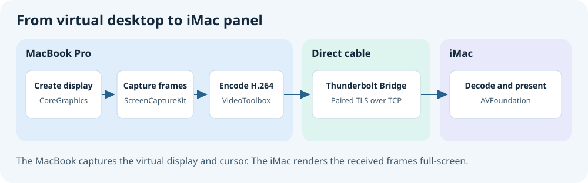
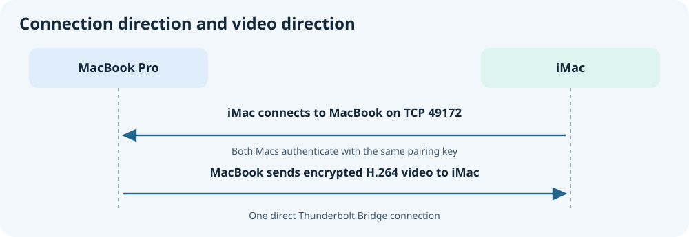

# Mac Extend architecture

Mac Extend turns a 2017 Retina 4K iMac into a second screen for a MacBook Pro. macOS creates a separate desktop on the MacBook, so you can drag windows and the pointer across as you would with an external monitor. The iMac runs the receiver and draws that desktop in a full-screen window. The two computers use the Thunderbolt cable as a direct network link.

## How a frame gets from one Mac to the other



1. **Create the desktop.** The sender creates a virtual display through CoreGraphics and keeps it alive for the session. The small Objective-C bridge looks up the private `CGVirtualDisplay` classes at runtime. This is the part most likely to need revisiting after a macOS update.
2. **Capture the video.** ScreenCaptureKit selects the virtual display by its ID. It captures its pixels and cursor as video buffers, targeting up to 60 frames per second. The MacBook needs macOS Screen Recording permission. [Apple’s ScreenCaptureKit guide](https://developer.apple.com/documentation/screencapturekit/capturing-screen-content-in-macos)
3. **Compress the frame.** VideoToolbox uses one hardware H.264 compression session for the stream. The sender uses NV12 buffers, disables frame reordering, and allows up to two in-flight frames through encoding and sending. If both slots are occupied, it skips the incoming frame to limit the backlog. [Apple’s VideoToolbox documentation](https://developer.apple.com/documentation/videotoolbox)
4. **Send it over the cable.** The app packages the compressed H.264 bytes, the codec’s sequence and picture parameter sets (SPS and PPS), and a sync-frame flag. A length prefix lets the receiver extract each frame from the TCP byte stream. The connection uses TLS with a shared pairing key and is restricted to the selected Thunderbolt Bridge interface.
5. **Play it on the iMac.** The receiver rebuilds a Core Media sample buffer from the packet and enqueues it on an `AVSampleBufferDisplayLayer` with the display-immediately flag. AVFoundation handles decoding and presentation. [Apple’s playback layer documentation](https://developer.apple.com/documentation/avfoundation/avsamplebufferdisplaylayer)

The cursor travels in the video frame. Its feel depends on the capture interval, encoding, transport, decoding, and display refresh together. The MacBook’s fps counter measures frames submitted successfully to the network connection. It can report fewer frames on a static desktop because ScreenCaptureKit can skip unchanged frames.

## Who starts the connection



The MacBook’s **Start Sharing** action launches a sender that listens on TCP port **49172**. The iMac’s **Connect** action initiates the connection. Video then flows from the MacBook to the iMac. We settled on this direction after TCP connections initiated toward the iMac timed out on the original pair, even though the Thunderbolt link was up.

The app accepts the configured peer’s link-local IPv4 address, in the `169.254.x.x` range. Network.framework binds the session to the selected Thunderbolt Bridge interface, usually `bridge0`. Both Macs use the same 256-bit key for TLS authentication. The app operates without a cloud relay, an account, or an internet connection.

**Pair Macs** opens a separate connection on the same Thunderbolt interface, on TCP port **49173**, only during pairing. Each Mac commits to an ephemeral X25519 public key and random nonce before revealing them. CryptoKit derives the six-digit comparison code and a separate 256-bit video key. After users confirm that the codes match on both screens, the two peers verify each other’s approval with HMAC and save the derived key in each Mac’s app support folder. The setup window reuses that key on subsequent connections. Manual `pairing.key` import and export remain available for older setups.

Both Macs run the same universal app bundle. The AppKit setup window remembers the role, optional manual peer address, and display settings. The MacBook advertises pairing or video with Bonjour, and the iMac browses on its Thunderbolt Bridge. Video discovery uses a pairing-key-derived identifier and the stream still requires TLS authentication with the saved key. It launches the bundled executable as a sender or receiver worker and reads status messages from that worker. The live receiver opens its own window and enters standard macOS full screen when video arrives if the window is in front.

## Resolution and text size

| Mode | Video sent to the iMac | Encoder |
| --- | --- | --- |
| **1440p** | 2560 × 1440 | Hardware H.264 with low-latency rate control |
| **Native 4K** | 4096 × 2304, the panel resolution of the 2017 Retina 4K iMac | Standard real-time hardware H.264 |

Resolution controls the video sent over the cable. Text size controls how much desktop space macOS presents. In Native 4K, **Standard** looks like 2048 × 1152 and renders at 2×, matching the panel. **Large** looks like 1920 × 1080 and renders at 3840 × 2160 before capture scales it to 4096 × 2304. **Extra large** looks like 1600 × 900. Native 4K with **Large** was the preferred combination in the hands-on test on our two Macs.

The low-latency H.264 configuration worked at 1440p. The native 4K probe succeeded with the standard real-time hardware encoder, so the app uses that encoder at 4K. A 60 Hz virtual display mode establishes the requested refresh rate. The actual stream rate depends on motion and what both Macs can process.

## Where to start in the code

| File | What to read |
| --- | --- |
| [DesktopApp.swift](Sources/DisplayPrototype/DesktopApp.swift) | Start with `toggleConnection()` and `launchWorker()` to see what happens when you click Start Sharing or Connect. |
| [main.swift](Sources/DisplayPrototype/main.swift) | The entry point opens the app window, dispatches worker commands, creates the virtual display on the sender, and removes it when the sender stops. |
| [DisplayBridge.m](Sources/DisplayBridge/DisplayBridge.m) | The Objective-C layer sets up the display’s size, HiDPI mode, and refresh rate. |
| [CaptureProbe.swift](Sources/DisplayPrototype/CaptureProbe.swift) and [StreamProbe.swift](Sources/DisplayPrototype/StreamProbe.swift) | `virtualDisplayFilter()` picks the virtual display. `checkStream()` starts continuous capture in both the live sender and the timed diagnostic. |
| [EncoderProbe.swift](Sources/DisplayPrototype/EncoderProbe.swift) and [VideoResolution.swift](Sources/DisplayPrototype/VideoResolution.swift) | `makeEncoder()` sets up the hardware codec. The resolution type holds supported dimensions and bitrate targets. |
| [Pairing.swift](Sources/DisplayPrototype/Pairing.swift) | `MacPairingAttempt` opens the temporary pairing connection and runs the code comparison and key exchange. |
| [WiredLink.swift](Sources/DisplayPrototype/WiredLink.swift), [PairedTLS.m](Sources/DisplayBridge/PairedTLS.m), and [VideoWire.swift](Sources/DisplayPrototype/VideoWire.swift) | The first file binds and opens the connection, the second configures TLS pairing, and the third serializes and reconstructs the video samples. |
| [Receiver.swift](Sources/DisplayPrototype/Receiver.swift) | Read `receive()` to follow a compressed frame from the connection to the AppKit playback window. `DecoderProbe.swift` tests decoding separately from that window. |

## Build and check

The project uses Swift Package Manager with a Swift executable target and a small Objective-C target. Open [Package.swift](Package.swift) in Xcode, or run `swift build` from the project directory with Apple’s Swift tools. The Finder app combines Apple silicon and Intel release builds into one universal binary. [Info.plist](macOS/Info.plist) supplies the app name, macOS 13 minimum, and icon reference.

From the project directory on the MacBook:

```sh
swift run display-prototype --check
swift run display-prototype --check-capture-encode
swift run display-prototype --check-codec --resolution 4k
swift run display-prototype --check-transport --resolution 4k
swift run display-prototype --check-pairing
```

These checks cover different parts of the pipeline. The first creates and removes an extended desktop. The second captures and encodes a frame with Screen Recording permission. The codec and transport checks use synthetic frames, including rejection of a mismatched key. The pairing check exercises the exchange and uses its derived key for a synthetic video transfer. For an end-to-end test, use the app on both Macs, drag a window or scroll continuously, and compare 1440p and 4K on the iMac. The [setup guide](README.md) gives the connection steps.
