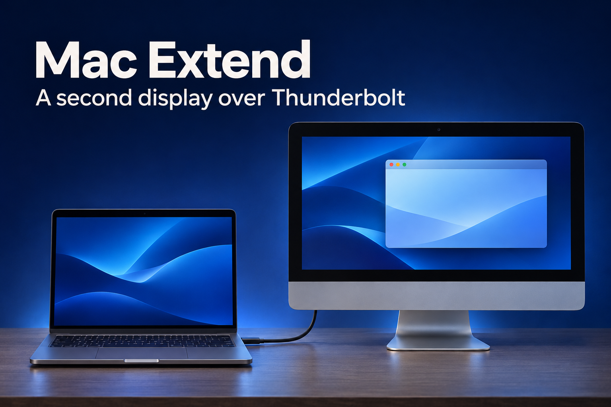
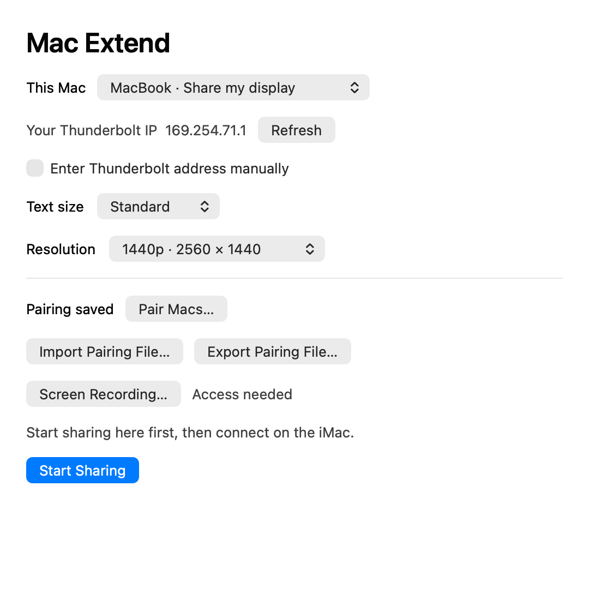

# Mac Extend



Use a 2017 Retina 4K iMac as a second display for a MacBook Pro over a direct Thunderbolt connection. Mac Extend creates a separate desktop on the MacBook, so you can drag a window onto the iMac while continuing to use the MacBook’s built-in screen.

## What you need

- A MacBook Pro for sharing and a Mac running the receiver. The original setup used an Apple silicon MacBook Pro and a 2017 Intel iMac running macOS Ventura.
- macOS 14 or later on the MacBook and macOS 13 or later on the receiver.
- A direct Thunderbolt 3 cable between the Macs.
- A copy of Mac Extend on each Mac. Use a compatible packaged build or [build the app from source](#build-from-source).

## Connect both Macs



*MacBook setup window with an example Thunderbolt IP address.*

1. Connect the Thunderbolt cable and open **Mac Extend** on both Macs.
2. Under **This Mac**, select **MacBook · Share my display** on the MacBook and **iMac · Show the extended display** on the iMac. If either Mac says its Thunderbolt IP is unavailable, click **Refresh** after checking the cable and **System Settings → Network → Thunderbolt Bridge**.
3. On the first connection, click **Pair Macs…** on the MacBook. When it says it’s ready, click **Pair Macs…** on the iMac. Compare the six-digit codes and click **Codes Match** on both only if the codes agree. Mac Extend saves the pairing for later sessions.
4. On the MacBook, choose your resolution and text size, then click **Start Sharing**. Allow Screen Recording for Mac Extend if prompted and reopen it if macOS asks. Allow Local Network access if macOS prompts on either Mac.
5. When the MacBook says **Ready**, click **Connect** on the iMac. On the MacBook, open **System Settings → Displays → Arrange** to position the virtual display on the same side as the physical iMac. Drag a window across to try it.

For later sessions, use **Start Sharing** on the MacBook, then **Connect** on the iMac. Bonjour discovers the MacBook over Thunderbolt, even if its IP changed. The manual address checkbox is available for troubleshooting.

Click **Stop** on the MacBook before closing the app. If a window stays on the virtual desktop, start sharing again and move the window back to the MacBook before stopping.

### Resolution and text size

Start with **1440p**. Try **Native 4K** to stream at the 2017 Retina 4K iMac’s 4096 × 2304 panel resolution. **Text size** changes how large the UI appears on the virtual desktop, independently of the selected stream resolution.

### If macOS asks for Screen Recording again

On the MacBook, click **Screen Recording… → Open Settings** to grant access. If the switch is already enabled after an update but sharing still asks for permission, choose **Reset Mac Extend Permission** from the same dialog. Quit and reopen that copy, then click **Start Sharing** and grant access again. The reset applies to Mac Extend’s Screen Recording permission.

## Build from source

From the repository root on each Mac, using Apple’s Swift tools:

```sh
swift build -c release
app="Mac Extend.app"
mkdir -p "$app/Contents/MacOS" "$app/Contents/Resources"
cp "$(swift build -c release --show-bin-path)/display-prototype" "$app/Contents/MacOS/iMacExtendedDisplay"
cp macOS/Info.plist "$app/Contents/Info.plist"
cp macOS/AppIcon.icns "$app/Contents/Resources/"
codesign --force --sign - "$app"
open "$app"
```

This builds for the Mac you run it on. A build for Apple silicon and Intel can combine the two executables into one universal app. See the [architecture notes](ARCHITECTURE.md#build-and-check) for diagnostics.

## How it works

Swift coordinates the AppKit interface, ScreenCaptureKit capture, VideoToolbox hardware H.264 encoding, the Thunderbolt network connection, and AVFoundation playback. Bonjour discovers the sender and the Macs authenticate the video stream with their saved pairing key over TLS.

The virtual display uses an Objective-C bridge to undocumented Core Graphics classes, so macOS updates can affect compatibility. The [architecture guide](ARCHITECTURE.md) explains the video pipeline, pairing, and resolution trade-offs.
